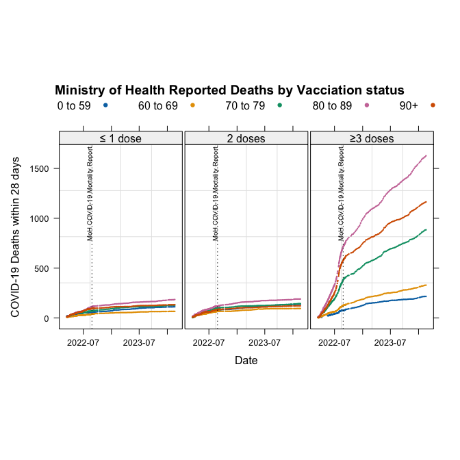
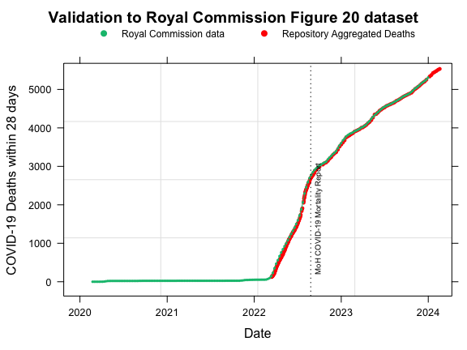

# COVID-19-Ministry-of-Health-dashboard-data

Dashboard data collected from Ministry of Health website between 11 February 2022 and 18 February 2024


## Deaths by Vaccination Status in New Zealand

The deaths dataset provided in [`covid_healthdata.xlsx`](https://github.com/sven86-99/COVID-19-Ministry-of-Health-dashboard-data/blob/main/covid_healthdata.xlsx) additionally contains explanatory variables for _Age group_, and _Vaccination Status_.




## Validation against New Zealand Royal Commission COVID-19 data

The Royal Commission remit did not investigate vaccine effectiveness, as a consequence data
was presented as a cumulative count of all COVID-19 Deaths within 28 days of being reported
as a COVID-19 case.

When aggregated across *Age group* and *Vaccination Status*, this dataset produces mortality figures that closely correspond to [__mortality data__](https://www.covid19lessons.royalcommission.nz/assets/Uploads/figure020-data-v2.csv)  published in Figure 20 of the NZ Royal Commission [__COVID-19 by the Numbers__](https://www.covid19lessons.royalcommission.nz/reports-lessons-learned/covid-19-by-the-numbers/figures-and-tables) report.



## Summary

This data collected in [`covid_healthdata.xlsx`](https://github.com/sven86-99/COVID-19-Ministry-of-Health-dashboard-data/blob/main/covid_healthdata.xlsx) provides information around Cases, Hospitalization, and Deaths by Vaccination Status
which the Ministry of Health publicly disclosed on its website which is not in concordance with their
own subsequent publications. On 29 September 2022 the Ministry of Health published the report
`COVID-19 MORTALITY IN AOTEAROA NEW ZEALAND September 2022`.

* https://www.health.govt.nz/system/files/2022-09/covid-19_mortality_in_aotearoa_inequities_in_risk_september_2022_29_sept.v2.pdf


Pages 27 and 28 in the Appendix of this report highlight that the driving variables of _mortality risk_ and
_case fatality risk_ per 100,000 people from 1 January to 26 August 2022 were:

1. Age Group; and

2. Any hospital identified co-morbidity.

The dashboard data presented above raise questions about why the regression analyses in the
Ministry of Health report [COVID-19 MORTALITY IN AOTEAROA NEW ZEALAND September 2022](https://www.health.govt.nz/system/files/2022-09/covid-19_mortality_in_aotearoa_inequities_in_risk_september_2022_29_sept.v2.pdf)
simplified the vaccination status categories, effectively excluding the
__≥3 doses__ category from the regression models.

A further question is why, in light of the evidence provided and data available to the
Ministry of Health, regression models were not subsequently updated and reported for
2023, 2024 and 2025 using the same statistical methodology. Applying a consistent methodology
across these years would have allowed the results to be compared over time.

As with Statistics New Zealand’s advice to the Ministry of Health to use the HSU 2021 dataset,
independent statistical analysis of publicly released data is recommended to assess the methodology,
statistical rigor, and validate the reported findings to evaluate the robustness of conclusions drawn from the Ministry of Healths underlying proprietary collected datasets during COVID-19.

This evidence, drawn from the Ministry of Health’s publicly available dashboard data,
raises significant questions about the rationale for excluding comparisons of health outcomes
between vaccinated and unvaccinated populations from the remit of the 
_[Royal Commission of Inquiry into COVID-19 Lessons Learned (Phase One and Phase Two)](https://www.covid19lessons.royalcommission.nz)_

## Contents


| Document      | Reference                                                                                               |
|---------------|---------------------------------------------------------------------------------------------------------|
| Source code   | https://github.com/sven86-99/COVID-19-Ministry-of-Health-dashboard-data/blob/main/report.Rmd            |
| Markdown      | https://github.com/sven86-99/COVID-19-Ministry-of-Health-dashboard-data/blob/main/report.md             |
| pdf report    | https://github.com/sven86-99/COVID-19-Ministry-of-Health-dashboard-data/blob/main/report.pdf            |
| Excel dataset | https://github.com/sven86-99/COVID-19-Ministry-of-Health-dashboard-data/blob/main/covid_healthdata.xlsx |


Scalable vector graphic copies of graphs under [svg](https://github.com/sven86-99/COVID-19-Ministry-of-Health-dashboard-data/tree/main/svg) sub directory

```
svg
├── cases.svg
├── deaths.svg
├── hospitalization.svg
├── ICU.svg
├── log_cases.svg
├── log_hospitalization.svg
└── log_ICU.svg
```


## Additional data sources

The `vaccine-data` directory containing weekly sub-directories with snapshots of the
New Zealand Health Service User (HSU) population csv files managed by the Ministry of Health
is from:

https://github.com/minhealthnz/nz-covid-data/tree/main/vaccine-data

```
vaccine-data
├── 2021-08-31
├── 2021-09-07
├── 2021-09-14
├── 2021-09-21
├── 2021-09-28
├── 2021-10-05
├── 2021-10-12
├── 2021-10-19
├── 2021-10-26
├── 2021-11-03
├── 2021-11-10
├── 2021-11-17
├── 2021-11-24
├── 2021-12-01
├── 2021-12-08
├── 2021-12-15
├── 2021-12-22
├── 2021-12-29
├── 2022_02_09
├── 2022-01-05
├── 2022-01-12
├── 2022-02-16
├── 2022-02-23
├── 2022-03-02
├── 2022-03-09
├── 2022-03-16
├── 2022-03-23
├── 2022-03-30
├── 2022-04-06
├── 2022-04-13
├── 2022-04-20
├── 2022-04-27
├── 2022-05-04
├── 2022-05-11
├── 2022-05-18
├── 2022-05-25
├── 2022-06-01
├── 2022-06-08
├── 2022-06-15
├── 2022-06-22
├── 2022-06-29
├── 2022-07-06
├── 2022-07-13
├── 2022-07-20
├── 2022-07-27
├── 2022-08-03
├── 2022-08-10
├── 2022-08-17
├── 2022-08-24
├── 2022-08-31
├── 2022-09-07
├── 2022-09-14
├── 2022-09-21
├── 2022-09-28
├── 2022-10-05
├── 2022-11-02
├── 2022-12-07
├── 2023-01-11
├── 2023-02-01
├── 2023-03-01
├── 2023-04-05
├── 2023-05-03
├── latest
├── README.md
└── sa2-data
```

Specifically of interest is the HSU 2020 and HSU 2021 datasets.
