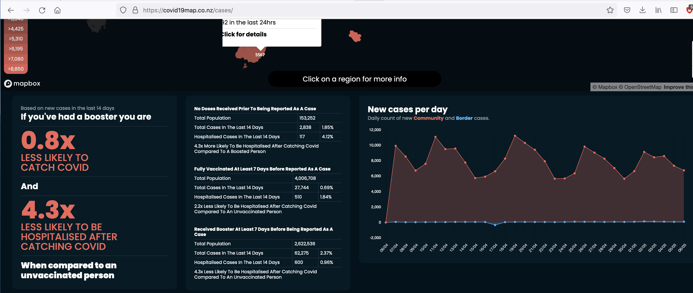
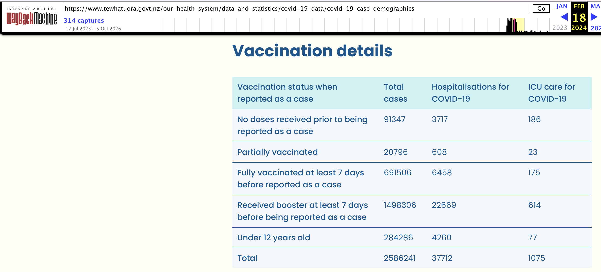
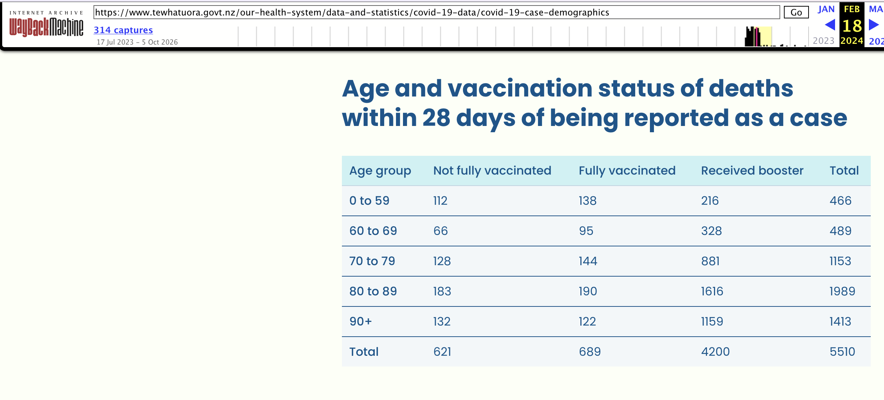
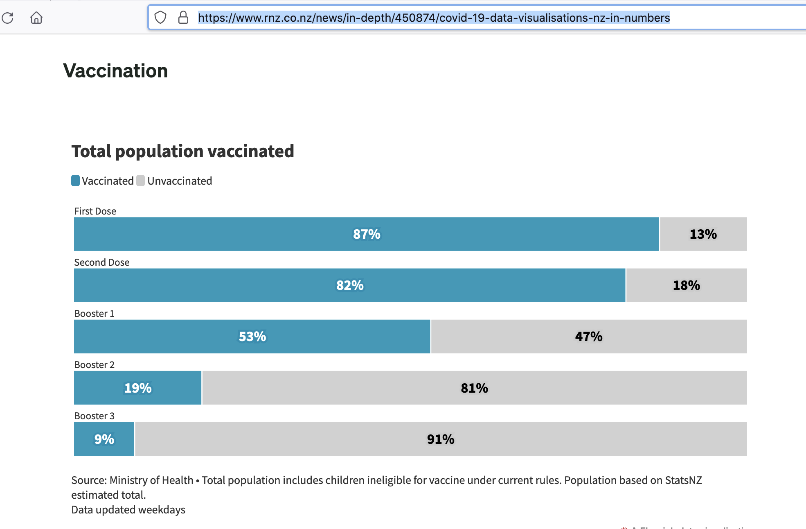

```{r setup, include=FALSE}
knitr::opts_chunk$set(echo = TRUE, 
                      fig.width = 5,
                      fig.height = 5 * 0.75) ## , fig.path=""


library(car)
library(data.table)
library(dplyr)
library(lattice)
library(ggplot2)
library(gridExtra)
library(readxl)
library(testthat)
library(tidyr)


## Draw a border around graphs
draft  <- FALSE

## Set directory for SVG images
svgDir <- "svg"
dir.create(svgDir, showWarning = FALSE)

borderSettings <- list(
  layout.widths = list(
    left.padding = 0,
    right.padding = -1.5
  ),
  layout.heights = list(
    top.padding = 0.75,
    bottom.padding = -1
  )
)
```


## Introduction

The New Zealand Te Whatu Ora, Ministry of Health (MoH) reported COVID-19 data metrics to the public on their website:

**https://www.health.govt.nz/covid-19-novel-coronavirus/covid-19-data-and-statistics/covid-19-case-demographics**

Data was recorded and updated:

1. Daily between 11 February 2022 and 12 September 2022; and

2. Weekly between 13 September 2022 and 18 February 2024.

\vspace{0.5cm}

The Ministry of Health stopped reporting metrics by vaccination status after 18 February 2024.

Metrics for Cases, Hospitalization, and Deaths of people in New Zealand within 28 days of being reported as a COVID-19 case were stratified on vaccination type and partially by age. This information was collated from the Ministry of Health website and entered into an excel spreadsheet [`covid_healthdata.xlsx`](https://github.com/sven86-99/COVID-19-Ministry-of-Health-dashboard-data/blob/main/covid_healthdata.xlsx) available in the GitHub repository. The authenticity of the dataset made available to the public in [`covid_healthdata.xlsx`](https://github.com/sven86-99/COVID-19-Ministry-of-Health-dashboard-data/blob/main/covid_healthdata.xlsx) can be verified from snapshots over time still available in the wayback machine.

**https://web.archive.org/web/20260000000000*/https://www.health.govt.nz/covid-19-novel-coronavirus/covid-19-data-and-statistics/covid-19-case-demographics**

\vspace{0.5cm}

The random variables the Ministry of Health New Zealand reported to the public were;

| Type                       | Description                                                                                                      |
|:------------------------------------------|:--------------------------------------------------------------------------------------------------|
| Vaccination&nbsp;Uptake&#95;HSU 2021 | Numbers of people single/double/triple vaccinated _-not sufficiently stratified by age category_       |
| COVID-19 Cases             | Reported cases of COVID-19 by vaccination status                                                                 |
| COVID-19 Hospitalizations  | Reported cases requiring hospitalization by vaccination status                                                   |
| COVID-19 ICU               | Reported cases requiring ICU Hospitalization by vaccination status                                               |
| COVID-19 Deaths            | Reported deaths by vaccination status partially stratified by age category                                       |


The information made publicly available by the Ministry of Health represents only a subset of the metrics collected and maintained within its proprietary databases.

The publicly disclosed data lack sufficient age group detail and concise categorisation of vaccination status to support reliable population standardisation (for example, rates per 100,000 people) or comprehensive relative-risk analysis. The publication of Deaths in age categories (0–59, 60–69, 70-79, 80-89, 90+ years) may have been restricted because a small number of deaths within lower age categories could increase the likelihood of identifying individuals and potentially compromising privacy.

\pagebreak

## Underestimation of the Population

Prior to 4 August 2022, the Ministry of Health underestimated New Zealand’s population, resulting in a significant downward bias in the estimated number of unvaccinated people. This discrepancy arose because the Ministry of Health used the HSU 2020 dataset before the HSU 2021 dataset became available. The resulting population estimate introduced bias into the metrics used to calculate relative risks between vaccinated and unvaccinated populations. The Ministry’s public announcement below acknowledges the issue but, in doing so, understates its significance for estimating the number of unvaccinated people in New Zealand.

**https://www.youtube.com/watch?v=tL06sCjQHxo&t=364s**


While vaccination records are expected to be reasonably accurate because individuals vaccinations were recorded in the relevant databases, the estimated total population was significantly understated. Following the transition to the updated HSU 2021 dataset, the residual population classified as unvaccinated increased by approximately 233,000 people, around 85% of whom were aged 12 or older. Consequently, the estimated unvaccinated population was substantially larger than the figure used in Ministry of Health publications prior to 4 August 2022.

\begin{equation}
\begin{aligned}
\uparrow N_{total} &= N_{vaccinated} \;+ \uparrow N_{unvaccinated}
\end{aligned}
\end{equation}

This has important implications for interpreting reported infection rates and other relative risk measures in any publication prior to 4 August 2022 when comparing vaccinated to unvaccinated. For example, if prior to using the HSU 2021 database the unvaccinated population over the age of 12 was estimated to be 153,252 people, this would increase to $153,252 + 233,000 \times 0.85 = 351302$ unvaccinated, a multiplier of $351302/153252 = 2.29$ times. The following screen shot was taken on 8 May 2022 from https:<span>//</span>covid19map.co.nz/cases. 

\vspace{0.5cm}

```{r, echo=FALSE, out.width=470, fig.pos = "!h", fig.cap="Screenshot of https://covid19map.co.nz/cases on 2022-05-08 at 3.10.02 PM illustrates the underestimate in the total population using an estimate of 153,252 for the unvaccinated population"}

```


_Note: The relative risk of a person having a booster was 0.8x_ ___less___ _likely to catch COVID-19 than an unvaccinated person. This is actually in favour of the unvaccinated before using the HSU 2021 population. The equivalent parametrisation is that an unvaccinated person is $1/0.8 = 1.25x$_ ___less___ _likely to catch COVID-19 than a person having a booster._

\begin{equation}
\begin{aligned}
\frac{{2838/153252}}{{62275}/{2622536}} \approx 0.8x \quad &\mbox{becomes} \quad \frac{{2838/(153252 + 233000 \times 0.85)}}{{62275}/{2622536}} \approx 0.34x
\end{aligned}
\end{equation}

\pagebreak

## Ministry of Health Cases

The data were recorded as cumulative tallies, categorised by vaccination status and updated over time. One advantage of using cumulative data is that discrepancies or inconsistencies in the recorded figures may be identified and corrected by Ministry of Health staff as records are subsequently reviewed and updated. The source of the data came directly from the Ministry of Health dashboard provided to the public.

```{r, echo=FALSE, out.width=470, fig.pos = "!h", fig.cap="Snapshot example of https://web.archive.org/web/20260000000000*/https://www.health.govt.nz/covid-19-novel-coronavirus/covid-19-data-and-statistics/covid-19-case-demographics as at 24 February 2024"}

```

The data was collected in the following format:

```{r load_cases, echo=FALSE}
cases_raw <- read_xlsx("covid_healthdata.xlsx", col_types=c("date","text","numeric", "numeric", "numeric", "text", "numeric", "numeric", "numeric"), sheet="Vaccination", na = c("", "NA"))

## Coerce to integers
i <- vapply(cases_raw, is.numeric, logical(1)) &
     !vapply(cases_raw, inherits, logical(1), "Date") &
     !vapply(cases_raw, inherits, logical(1), "POSIXt")

cases_raw[i] <- lapply(cases_raw[i], as.integer)

## Remove the Total column
cases       <- subset(cases_raw, ! Type %in% "Total")
cases_total <- subset(cases_raw, Type %in% "Total")


cases$Status <- car::recode(cases$Type,
"'Received booster at least 7 days before being reported as a case' = 'Triple vax';
'Fully vaccinated at least 7 days before reported as a case' = 'Double vax';
'Partially vaccinated' = 'Single vax';
'No doses received prior to being reported as a case' = 'Unvaccinated'; 
'Not eligible for vaccine due to being less than 12 years old' = 'Not eligible';
'Not eligible for vaccination at the time they were reported as a case' = 'Not eligible';
'Under 12 years old' = 'Not eligible'")


knitr::kable(head(cases[,c("Date", "Status", "Cases", "Hospitalization", "ICU")]))

cases_wide <- spread(cases[, c("Date", "Status", "Cases")], Status, Cases)
```

Any decrease in a reported value relative to the preceding daily or weekly figure indicates a discrepancy in the published data. Such discrepancies may subsequently be corrected as the Ministry reviews and updates its records.

It should also be noted that the unvaccinated category is subject to a small degree of bias because cumulative data include a number of cases and hospitalisations recorded before vaccines became available. For an objective comparison, counts for all vaccination status categories should ideally be standardised to the same initial observation period. However, this standardisation has not been applied to the observational data presented here.

\pagebreak

### Reported Cases `r as.Date(min(cases$Date))` to `r as.Date(max(cases$Date))`

The metric provided was not stratified by any age categories.

```{r lattice_config, echo = FALSE}
## Lattice config
my_colours <- c("#0072B2", "#E69F00", "#009E73", "#CC79A7", "#D55E00")

## my_colours <- trellis.par.get("superpose.symbol")$col
## c("#0072B2", "#E69F00", "#009E73", "#D55E00", "#56B4E9", "#F0E442", "#CC79A7") #


status_levels <- c("Triple vax", "Unvaccinated", "Double vax", "Not eligible",  "Single vax")
## unique(cases$Status)[c(5,1,3,4,2)]
cases$Status <- factor(cases$Status, levels = status_levels)

par_superpose <- trellis.par.get("superpose.symbol")
par_superpose$col[1:5] <- my_colours
par_superpose$pch[1:5] <- 16
trellis.par.set("superpose.symbol", par_superpose)

myKey <- simpleKey(text=levels(cases$Status), columns=3, cex=0.7, points = TRUE, byrow = TRUE)
```


```{r plot_cases, echo=FALSE, fig.pos = "H", fig.cap = "Cases versus Time by Vaccination Status"}
plotObj <- xyplot(Cases ~ Date, data=cases,  main=list("MoH Reported Cases", cex=0.9),
				  groups=Status, type="b", key=myKey, col = my_colours, par.settings = borderSettings,
				  panel=function(x,y, ...){
  panel.superpose(x,y, pch=16, cex=0.3, ...)
  panel.abline(v=as.POSIXct("2022-05-3 0:00"), lty=3, col="black", lwd=0.4)
  
  panel.text(as.POSIXct("2022-05-3 0:00")-86400*12, 700000, "3 May 2022", srt=90, cex=0.4)
  panel.text(as.POSIXct("2022-05-3 0:00")+86400*12, 700000, "3 dose uptick", srt=90, cex=0.4)
})

if(draft) {
  plot.new()
  box(which = "outer", col = "red", lwd = 2)
}
print(plotObj, new = !draft)

svg(file.path(svgDir, "cases.svg"))
if(draft) {
  plot.new()
  box(which = "outer", col = "red", lwd = 2)
}
print(plotObj, new = !draft)
graphics.off()
```


```{r cases_crossover, echo = FALSE, eval = FALSE}
graph_crossover <- FALSE

moH <- x

if(graph_crossover){
  ggplot(moH, aes(Date, Cases, colour = Status)) +
		geom_line(linewidth = 0.7) +
		labs(
			x = "Date",
			y = "Number of cases",
			colour = "Vaccination status"
		) +
		theme_minimal()
}

moH_change <- moH |>
  arrange(Status, Date) |>
  group_by(Status) |>
  mutate(
    days = as.numeric(Date - lag(Date)),
    change = (Cases - lag(Cases)) / days,
    acceleration = (change - lag(change)) /
                    ((days + lag(days)) / 2)
  ) |>
  ungroup()

if(graph_crossover){
  ggplot(moH_change, aes(Date, acceleration, colour = Status)) +
		geom_line() +
		geom_hline(yintercept = 0, linetype = 2) +
		labs(
			x = "Date",
			y = "Change in daily case increase",
			colour = "Vaccination status"
		) +
		theme_minimal()
}

moH_wide <- moH |>
  select(Date, Status, Cases) |>
  pivot_wider(
    names_from = Status,
    values_from = Cases
  )

moH_wide <- moH_wide |>
  mutate(
    difference =
      `Triple vax` -
      `Double vax`
  )


knitr::kable(moH_wide |>
  mutate(Date = gsub("-", "&#8209;", Date))	|>
  mutate(
    crossover = difference > 0 &
                lag(difference) <= 0
  ) |>
  filter(crossover))
```

There is an acceleration of reported COVID-19 cases in the `Triple Vax` category, the crossover point is around 3 May 2022.
There were so few cases in the single dose category that a $\log_{10}$ transformation was also used.

```{r plot_logcases, echo=FALSE, fig.pos = "H", fig.cap = "log10(Cases) versus Time by Vaccination Status"}
plotObj <- xyplot(log10(Cases) ~ Date, data=cases, groups=Status, main=list("MoH Reported Cases", cex=0.9),
                  scales = list(y = list(at=1:10, label=sprintf("%0.f", 10^(1:10)))),  par.settings = borderSettings,
                  type="b", key=myKey, col = my_colours, panel=function(x,y, ...){
  panel.superpose(x, y, pch=16, cex=0.3, ...)
  panel.abline(v=as.POSIXct("2022-05-3 0:00"), lty=3, col="black", lwd=0.4)
  
  panel.text(as.POSIXct("2022-05-3 0:00")-86400*12, log10(1000000), "3 May 2022", srt=90, cex=0.4)
  panel.text(as.POSIXct("2022-05-3 0:00")+86400*12, log10(1000000), "3 dose uptick", srt=90, cex=0.4)
  panel.text(as.POSIXct("2022-07-11 0:00")+86400*15, log10(10000), "Classification errors", srt = 90, col="red", cex=0.4)
})

if(draft) {
  plot.new()
  box(which = "outer", col = "red", lwd = 2)
}
print(plotObj, new = !draft)


svg(file.path(svgDir, "log_cases.svg"))
if(draft) {
  plot.new()
  box(which = "outer", col = "red", lwd = 2)
}
print(plotObj, new = !draft)
graphics.off()
```

\pagebreak

This highlights a Ministry of Health classification error in data reporting which is subsequently corrected.

\pagebreak

### Reported Hospitalizations `r as.Date(min(cases$Date))` to `r as.Date(max(cases$Date))`

The metric provided was not stratified by any age categories.

```{r plot_hospitalization, echo = FALSE, fig.pos = "!h", fig.cap = "Hospitalization Cases versus Time by Vaccination Status"}

plotObj <- xyplot(Hospitalization ~ Date, data=cases,  main=list("MoH Reported Hospitalization", cex=0.9),
				  groups=Status, type="b", key=myKey, col = my_colours,  par.settings = borderSettings,
				  panel=function(x,y, ...){
  panel.superpose(x, y, pch=16, cex=0.3, ...)
  panel.abline(v=as.POSIXct("2022-06-02 0:00"), lty=3, col="black", lwd=0.4)
  
  panel.text(as.POSIXct("2022-06-02 0:00")-86400*12, 10000, "2 June 2022", srt=90, cex=0.5)
  panel.text(as.POSIXct("2022-06-02 0:00")+86400*12, 10000, "3 dose uptick", srt=90, cex=0.5)
  
  # panel.text(as.POSIXct("2022-07-11 0:00")+86400*12, 1000, "Classification errors", srt = 90, col="red", cex=0.6)
})

if(draft) {
  plot.new()
  box(which = "outer", col = "red", lwd = 2)
}
print(plotObj, new = !draft)

svg(file.path(svgDir, "hospitalization.svg"))
if(draft) {
  plot.new()
  box(which = "outer", col = "red", lwd = 2)
}
print(plotObj, new = !draft)
graphics.off()
```

There is an acceleration of reported COVID-19 cases in the `Triple Vax` category, the crossover point is around 2 June 2922. This is a lag of around a month from the Case crossover point of 3 May 2022.

```{r hospitalization_crossover, echo = FALSE, eval = FALSE}
graph_crossover <- TRUE

moH <- x

if(graph_crossover){
  ggplot(moH, aes(Date, Hospitalization, colour = Status)) +
		geom_line(linewidth = 0.7) +
		labs(
			x = "Date",
			y = "Number of Hospitalizations",
			colour = "Vaccination status"
		) +
		theme_minimal()
}

moH_change <- moH |>
  arrange(Status, Date) |>
  group_by(Status) |>
  mutate(
    days = as.numeric(Date - lag(Date)),
    change = (Hospitalization - lag(Hospitalization)) / days,
    acceleration = (change - lag(change)) /
                    ((days + lag(days)) / 2)
  ) |>
  ungroup()

if(graph_crossover){
  ggplot(moH_change, aes(Date, acceleration, colour = Status)) +
		geom_line() +
		geom_hline(yintercept = 0, linetype = 2) +
		labs(
			x = "Date",
			y = "Change in daily Hospitalization increase",
			colour = "Vaccination status"
		) +
		theme_minimal()
}

moH_wide <- moH |>
  select(Date, Status, Hospitalization) |>
  pivot_wider(
    names_from = Status,
    values_from = Hospitalization
  )

moH_wide <- moH_wide |>
  mutate(
    difference =
      `Triple vax` -
      `Double vax`
  )


knitr::kable(moH_wide |>
  mutate(Date = gsub("-", "&#8209;", Date))	|>
  mutate(
    crossover = difference > 0 &
                lag(difference) <= 0
  ) |>
  filter(crossover))
```

\pagebreak

There are also so few cases in the single dose category that a $\log_{10}$ transformation is required. 

```{r plot_logHospitalization, echo = FALSE, fig.pos = "!h", fig.cap = "log10(Hospitalization Cases) versus Time by Vaccination Status"}
plotObj <- xyplot(log10(Hospitalization) ~ Date, data=cases, groups=Status,
				   main=list("MoH Reported Hospitalization", cex=0.9), par.settings = borderSettings,
				   scales = list(y = list(at=1:10, label=sprintf("%0.f", 10^(1:10)))),
                  type="b", key=myKey, col = my_colours, panel=function(x,y, ...){
  panel.superpose(x, y, pch=16, cex=0.3, ...)
  panel.abline(v=as.POSIXct("2022-06-02 0:00"), lty=3, col="black", lwd=0.4)
  
  panel.text(as.POSIXct("2022-06-02 0:00")-86400*12, log10(13000), "2 June 2022", srt=90, cex=0.4)
  panel.text(as.POSIXct("2022-06-02 0:00")+86400*12, log10(13000), "3 dose uptick", srt=90, cex=0.4)
  
  panel.text(as.POSIXct("2022-07-11 0:00")+86400*12, log10(100), "Reporting errors", srt = 90, col="red", cex=0.4)
})

if(draft) {
  plot.new()
  box(which = "outer", col = "red", lwd = 2)
}
print(plotObj, new = !draft)

svg(file.path(svgDir, "log_hospitalization.svg"))
if(draft) {
  plot.new()
  box(which = "outer", col = "red", lwd = 2)
}
print(plotObj, new = !draft)
graphics.off()
```

This highlights a Ministry of Health reporting error which is subsequently corrected.

\pagebreak

### Reported ICU `r as.Date(min(cases$Date))` to `r as.Date(max(cases$Date))`

The metric provided was not stratified by any age categories.

```{r plot_ICU, echo = FALSE, fig.pos = "!h", fig.cap = "ICU Cases versus Time by Vaccination Status"}
plotObj <- xyplot(ICU ~ Date, data=cases,  main=list("MoH Reported ICU", cex=0.9),
                  groups=Status, type="b", key=myKey, col = my_colours, par.settings = borderSettings,
				  panel=function(x,y, ...){
  panel.superpose(x, y, pch=16, cex=0.3, ...)
})

if(draft) {
  plot.new()
  box(which = "outer", col = "red", lwd = 2)
}
print(plotObj, new = !draft)

svg(file.path(svgDir, "ICU.svg"))
if(draft) {
  plot.new()
  box(which = "outer", col = "red", lwd = 2)
}
print(plotObj, new = !draft)
graphics.off()
```

\pagebreak

There are also so few cases in the single dose category that a $\log_{10}$ transformation is required. 

```{r plot_logICU, echo = FALSE, fig.pos = "!h", fig.cap = "log10(ICU Cases) versus Time by Vaccination Status"}
plotObj <- xyplot(log10(ICU) ~ Date, data=cases, groups=Status, main=list("MoH Reported ICU", cex=0.9),
                  scales = list(y = list(at=1:10, label=sprintf("%0.f", 10^(1:10)))), par.settings = borderSettings,
                  type="b", key=myKey, col = my_colours, panel=function(x,y, ...){
  panel.superpose(x, y, pch=16, cex=0.3, ...)
  # panel.abline(v=as.POSIXct("2022-05-3 0:00"), lty=3, col="black", lwd=0.4)
  # panel.text(as.POSIXct("2022-07-11 0:00")+86400*15, log10(1000), "Classification errors", srt = 90, col="red", cex=0.8)
})

if(draft) {
  plot.new()
  box(which = "outer", col = "red", lwd = 2)
}
print(plotObj, new = !draft)

svg(file.path(svgDir, "log_ICU.svg"))
if(draft) {
  plot.new()
  box(which = "outer", col = "red", lwd = 2)
}
print(plotObj, new = !draft)
graphics.off()
```

```{r, echo = FALSE, eval = FALSE}
## The classification data error in `Cases` is the following records
cases_wide$Total <- rowSums(cases_wide[,-1], na.rm=TRUE)
knitr::kable(cases_wide[140:152,])
```

\pagebreak

## Ministry of Health reported Deaths

The data were recorded as cumulative tallies, categorised by vaccination status and (partially) stratified by age over time. One advantage of using cumulative data is that discrepancies or inconsistencies in the recorded figures may be identified and corrected by Ministry of Health staff as records are subsequently reviewed and updated. 

The source of the data came directly from the Ministry of Health dashboard provided to the public.

```{r, echo=FALSE, out.width=470, fig.pos = "!h", fig.cap="Snapshot example of https://web.archive.org/web/20260000000000*/https://www.health.govt.nz/covid-19-novel-coronavirus/covid-19-data-and-statistics/covid-19-case-demographics as at 24 February 2024"}

```

The data was collected in the following format:

```{r load_deaths, echo = FALSE}
deaths_raw <- read_xlsx("covid_healthdata.xlsx", sheet = "Deaths", col_types=c("date","text","numeric", "numeric", "numeric", "numeric", "text", "numeric", "numeric", "numeric", "numeric"), na = c("*", "NA"))

## Remove column name spaces
names(deaths_raw) <- gsub(" ", "_", names(deaths_raw))

## Remove the Total column
deaths <- subset(deaths_raw, subset=! Age_group %in% "Total", select = c(Date, Age_group, Not_fully_vaccinated, Fully_vaccinated, Received_booster))
deaths_total <- subset(deaths_raw, subset=Age_group %in% "Total", select = c(Date, Age_group, Not_fully_vaccinated, Fully_vaccinated, Received_booster))

## Narrow format
deaths_gather <- gather(deaths, Status, Deaths, -Date, -Age_group)

deaths_gather$Status <- factor(deaths_gather$Status, levels=unique(deaths_gather$Status), labels=c("≤ 1 dose", "2 doses",  "≥3 doses"))

knitr::kable(head(deaths, n=5))
```

Any decrease in a reported value relative to the preceding daily or weekly figure indicates a discrepancy in the published data. Such discrepancies may subsequently be corrected as the Ministry reviews and updates its records.

It should also be noted that the unvaccinated category is subject to a small degree of bias because cumulative data include a number of deaths recorded before vaccines became available. For an objective comparison, counts for all vaccination status categories should ideally be standardised to the same initial observation period. However, this standardisation has not been applied to the observational data presented here.

\pagebreak

### Reported Deaths by Vaccination Status from 2022-02-11 to 2024-02-18 

This metric was partially stratified by age category. Essentially, it represents a tally of deaths among people who had contracted COVID-19 within the preceding 28 days. As the vaccination programme initially prioritised older people before progressively extending eligibility to younger age groups, vaccination status is correlated with age. Consequently, age is a
confounding variable when comparing mortality between vaccination groups. The potential for Simpson’s paradox must be considered when interpreting the metrics.

The vaccination status category explanatory variables were reparametrised for plotting:

| From                 | To         |
|:---------------------|:----------:|
| Not_fully_vaccinated | $\le1\;\mbox{dose}\:\:$ |
| Fully_vaccinated     | $\quad2\; \mbox{doses}$ |
| Received_booster     | $\ge3\;\mbox{doses}$ |


Visualising the cumulative COVID-19 Deaths over time conditioned on Vaccination Status, and Age category.


```{r plot_deaths, echo = FALSE, fig.height = 4.75, fig.width = 7, fig.pos = "H", fig.cap = "Deaths versus Time conditioned by Vaccination Status and a legend for Age categories. The cumulative trend suggests that deaths due to COVID-19 were significantly higher in the vaccinated group with __>=3 doses__ across all age groups."}
borderSettingsLocal <- list(
  layout.widths = list(
    left.padding = 0,
    right.padding = -1.5
  ),
  layout.heights = list(
    top.padding = 0,
    bottom.padding = -0.5
  )
)

myKey <- simpleKey(text=sort(unique(deaths$Age_group)), columns=5, cex = 0.8, space = "top")
 
plotObj <- xyplot(Deaths ~ Date | Status, data=deaths_gather, between=list(x=0.2, y=0.2), groups=Age_group,
				  aspect=1.5, scales=list(alternating=FALSE), key=myKey,  type="b", pch=16, cex=0.3,
                  main="Ministry of Health Reported Deaths by Vaccination status",
				  ylab = "COVID-19 Deaths within 28 days",
				  layout=c(3, 1), par.settings = borderSettingsLocal,
                  panel=function(x, y, ...){
                    panel.grid(...)
                    panel.superpose(x, y, col = my_colours, ...)
                    panel.abline(v=as.POSIXct("2022-08-26", tz="UTC"), lty=3)
                    panel.text(x=as.POSIXct("2022-08-26", tz="UTC")-15*24*3600, y=775, "MoH COVID-19 Mortality Report", srt=90, adj=0, cex = 0.6) #  ")
                  })

## MoH Report: COVID-19 MORTALITY IN AOTEAROA NEW ZEALAND September 2022

if(draft) {
  plot.new()
  box(which = "outer", col = "red", lwd = 2)
}
print(plotObj, new = !draft)

svg(file.path(svgDir, "deaths.svg"), height=4.75, width=7)
if(draft) {
  plot.new()
  box(which = "outer", col = "red", lwd = 2)
}
print(plotObj, new = !draft)
graphics.off()
```

\pagebreak 

### Validation against New Zealand Royal Commission COVID-19 data

The Royal Commission remit did not investigate vaccine effectiveness, as a consequence data
was presented as a cumulative count of all COVID-19 Deaths within 28 days of being reported
as a COVID-19 case.

The deaths dataset provided in [`covid_healthdata.xlsx`](https://github.com/sven86-99/COVID-19-Ministry-of-Health-dashboard-data/blob/main/covid_healthdata.xlsx) additionally contains explanatory variables for _Age group_, and _Vaccination Status_. 

When aggregated across *Age group* and *Vaccination Status*, this dataset produces mortality figures that closely correspond to [__mortality data__](https://www.covid19lessons.royalcommission.nz/assets/Uploads/figure020-data-v2.csv)  published in Figure 20 of the NZ Royal Commission [__COVID-19 by the Numbers__](https://www.covid19lessons.royalcommission.nz/reports-lessons-learned/covid-19-by-the-numbers/figures-and-tables) report.

```{r plot_rcdataset, echo = FALSE, fig.height = 6 * 0.75, fig.width = 6, fig.pos = "H", fig.cap = "New Zealand Royal Commission of Inquiry into COVID-19 Lessons Learned: [Figure 20](https://www.covid19lessons.royalcommission.nz/reports-lessons-learned/covid-19-by-the-numbers/4-covid-19-arrives-in-new-zealand/4-4-mortality), showing the Commission’s published [mortality data](https://www.covid19lessons.royalcommission.nz/assets/Uploads/figure020-data-v2.csv), overlaid with the death dataset in this repository aggregating over Status and Age"}

key_labels <- c("Royal Commission Figure 20 data", "MoH aggregated deaths")

myKey <- list(
  points = list(
    pch = 16,
    col = c("#00BF7D", "red"),
    cex = 1
  ),
  text = list(
    c("Royal Commission data", "Repository Aggregated Deaths"),
    cex = 0.75
  ),
  columns = 2
)

deaths_summary <- aggregate(
    Deaths ~ Date,
    data = deaths_gather,
    FUN = sum,
    na.rm = TRUE
)

fig20_df <- read.csv("figure020-data-v2.csv")

## Replace all dots with underscores
names(fig20_df) <- gsub("\\.", "_", names(fig20_df))
names(fig20_df) <- gsub("_$", "", names(fig20_df))

## Dates
fig20_df$Date <- as.Date(fig20_df$Week_ending, format = "%d/%m/%Y")

plotObj <- xyplot(Within_28_days__cumulative ~ Date, data=fig20_df, between=list(x=0.2, y=0.2), aspect=0.6, scales=list(alternating=FALSE), type = c("l", "p"), key=myKey,  pch=16, cex=0.4,
                  main="Validation to Royal Commission Figure 20 dataset",
				  ylab = "COVID-19 Deaths within 28 days",
				  layout=c(1, 1), par.settings = borderSettings,
                  panel=function(x, y, ...){
                    panel.grid(...)
                    ## Dashboard data
                    panel.xyplot(
                        as.Date(deaths_summary$Date),
                        deaths_summary$Deaths,
                        type = "p",
                        pch=16,
                        cex = 0.6,
                        col = "red",
                        lwd = 2
                    )
                    ## royal commission Fig20 data
                    panel.xyplot(x, y, col = "#00BF7D", ...)
                    panel.abline(v=as.Date("2022-08-26"), lty=3)
                    panel.text(x=as.Date("2022-08-26")+30, y=200, "MoH COVID-19 Mortality Report", srt=90, adj=0, cex = 0.6) #  ")
                  })

if(draft) {
  plot.new()
  box(which = "outer", col = "red", lwd = 2)
}
print(plotObj, new = !draft)

svg(file.path(svgDir, "royal_commission_Fig20.svg"), height = 6 * 0.75, width = 6)
if(draft) {
  plot.new()
  box(which = "outer", col = "red", lwd = 2)
}
print(plotObj, new = !draft)
graphics.off()
```

\pagebreak

### Vaccination versus Unvaccinated

Insufficient information was provided by the Ministry of Health to estimate relative risks between vaccinated and unvaccinated populations,
however the screenshot from 26 November 2023 provides an approximate snapshot at that date of the proportion of the New Zealand population categorized by vaccine status published by the Ministry of Health.

```{r, echo=FALSE, out.width=400, fig.pos = "!h", fig.cap="Screenshot from RNZ dashboard on 2023-11-26 at 9.16.30 AM"}

```

It can be inferred from Figure 9 that on 26 November 2023 the Vaccination categories in the New Zealand population were:

1. People with $\le 1\; \mbox{dose}$ equals 18\%;

2. Vaccinated people with $2 \; \mbox{doses}$ equals $82 - 53 = 29$\%;

3. Vaccinated people with $\ge 3\; \mbox{doses}$ equals 53\%.


On the 26 November 2023 when the screenshot capture of the Total Population Vaccinated was taken, the deaths by vaccination status partially stratified by age category was:

```{r deaths_2023_11_26, echo = FALSE}
knitr::kable(deaths[grep("2023-11-26", deaths$Date), ])
```

\pagebreak

The total deaths by vaccination status were:

```{r sumdeaths_2023_11_26, echo = FALSE}
knitr::kable(deaths_total[grep("2023-11-26", deaths_total$Date), ])
```

If the _Received_booster_ group represented 53% of the population on 26 November 2023, a naive null hypothesis of no association between booster vaccination status and mortality would suggest that this group would account for approximately 53% of deaths within 28 days of being reported as a COVID-19 case.

However, the reported figure is 75%. This apparent disparity warrants further investigation, even factoring that the _Received_booster_ group is likely to be disproportionately represented by older people, who generally have a higher underlying risk of death. Consequently, age is a confounding variable.

\begin{equation}
\begin{aligned}
100 \times \frac{3841}{\left( 596 + 663 + 3841\right)} = 75.3\%
\end{aligned}
\end{equation}


## Discussion

On 29 September 2022 the Ministry of Health published the report COVID-19 MORTALITY IN AOTEAROA NEW ZEALAND September 2022.

* https://www.health.govt.nz/system/files/2022-09/covid-19_mortality_in_aotearoa_inequities_in_risk_september_2022_29_sept.v2.pdf


Pages 27 and 28 in the Appendix of this report highlight that the driving variables of _mortality risk_ and _case fatality risk_ per 100,000 people from 1 January to 26 August 2022 were:

1. Age Group; and

2. Any hospital identified co-morbidity.

It should also be noted that the age weightings used to estimate fully adjusted risk are not provided in the report.

The dashboard data presented above raise questions about why the regression analyses in the
Ministry of Health report [COVID-19 MORTALITY IN AOTEAROA NEW ZEALAND September 2022](https://www.health.govt.nz/system/files/2022-09/covid-19_mortality_in_aotearoa_inequities_in_risk_september_2022_29_sept.v2.pdf) simplified the vaccination status categories, effectively excluding the $\ge 3\; \mbox{doses}$ category from the regression models.

A further question is why, in light of the evidence provided and data available to the Ministry of Health, regression models were not subsequently updated and reported for 2023, 2024 and 2025 using the same statistical methodology. Applying a consistent methodology across these years would have allowed the results to be compared over time.

As with Statistics New Zealand’s advice to the Ministry of Health to use the HSU 2021 dataset, independent statistical analysis of publicly released data is recommended to assess the methodology, statistical rigor, and validate the reported findings to evaluate the robustness of conclusions drawn from the Ministry of Healths underlying proprietary collected datasets during COVID-19.

This evidence, drawn from the Ministry of Health’s publicly available dashboard data, raises significant questions about the rationale for excluding comparisons of health outcomes between vaccinated and unvaccinated populations from the remit of the _[Royal Commission of Inquiry into COVID-19 Lessons Learned (Phase One and Phase Two)](https://www.covid19lessons.royalcommission.nz)_


```{r scratchpad, echo = FALSE, eval = FALSE}
## Find when dates changed from daily to weekly reporting
# 1. Obtain unique vector of dates
dates <- as.Date(unique(cases$Date))

# 2. Calculate the differences between consecutive dates
date_diffs <- as.numeric(diff(dates))

# 3. Classify each interval based on the number of days
classifications <- ifelse(date_diffs == 1, "Daily",
                     ifelse(date_diffs == 7, "Weekly", "Other/Gap"))

# 4. Combine into a clean summary data frame
# Note: Because diff() returns n-1 results, we pair each classification with its start date
result <- data.frame(
  Start_Date = dates[-length(dates)],
  End_Date   = dates[-1],
  Interval_Days = date_diffs,
  Frequency  = classifications
)

print(result)


#
## Sanity checks
#

## Sanity check the cases totals
expect_equal(as.integer(tapply(cases$Cases, cases$Date, sum)), cases_total$Cases)

## Sanity check the deaths totals - a few recording errors
table(as.integer(tapply(deaths$Not_fully_vaccinated, deaths$Date, sum)) - deaths_total$Not_fully_vaccinated)
table(as.integer(tapply(deaths$Not_fully_vaccinated, deaths$Date, sum)) - deaths_total$Not_fully_vaccinated)
table(as.integer(tapply(deaths$Fully_vaccinated, deaths$Date, sum)) - deaths_total$Fully_vaccinated)
table(as.integer(tapply(deaths$Received_booster, deaths$Date, sum)) - deaths_total$Received_booster)
```
