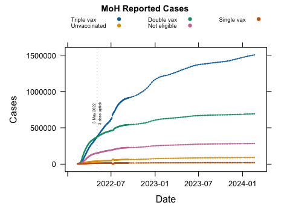
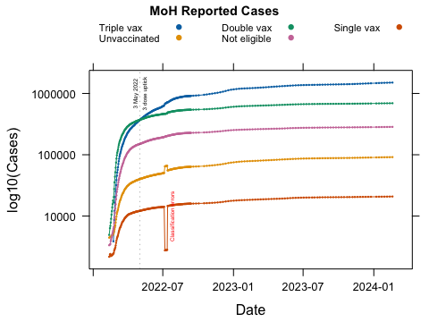
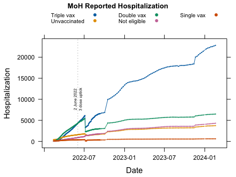
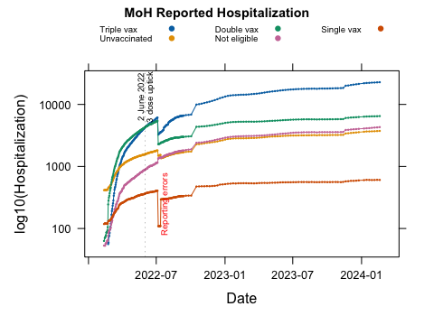
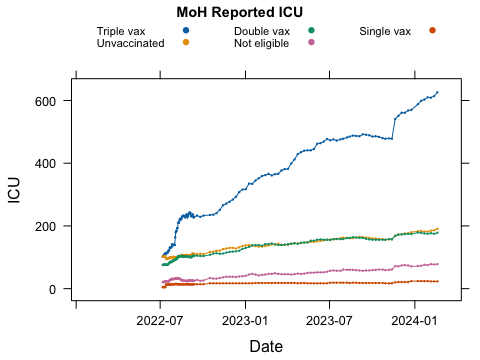
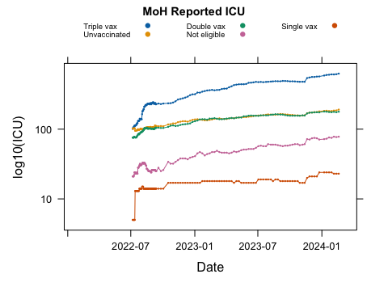
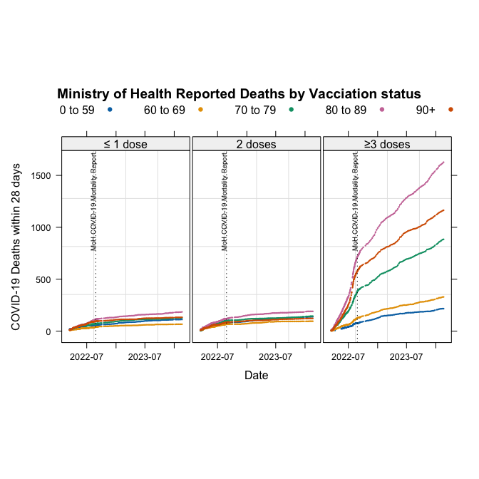
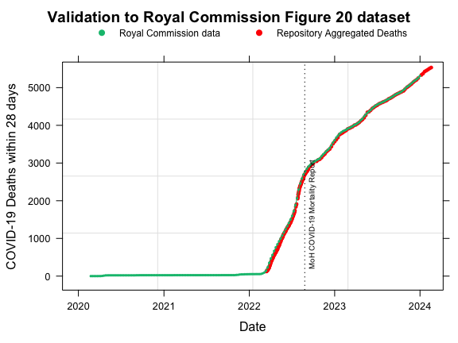

Ministry of Health COVID-19 metrics
================
14-11-2026

## Introduction

The New Zealand Te Whatu Ora, Ministry of Health (MoH) reported COVID-19
data metrics to the public on their website:

**<https://www.health.govt.nz/covid-19-novel-coronavirus/covid-19-data-and-statistics/covid-19-case-demographics>**

Data was recorded and updated:

1.  Daily between 11 February 2022 and 12 September 2022; and

2.  Weekly between 13 September 2022 and 18 February 2024.

The Ministry of Health stopped reporting metrics by vaccination status
after 18 February 2024.

Metrics for Cases, Hospitalization, and Deaths of people in New Zealand
within 28 days of being reported as a COVID-19 case were stratified on
vaccination type and partially by age. This information was collated
from the Ministry of Health website and entered into an excel
spreadsheet
[`covid_healthdata.xlsx`](https://github.com/sven86-99/COVID-19-Ministry-of-Health-dashboard-data/blob/main/covid_healthdata.xlsx)
available in the GitHub repository. The authenticity of the dataset made
available to the public in
[`covid_healthdata.xlsx`](https://github.com/sven86-99/COVID-19-Ministry-of-Health-dashboard-data/blob/main/covid_healthdata.xlsx)
can be verified from snapshots over time still available in the wayback
machine.

**<https://web.archive.org/web/20260000000000*/https://www.health.govt.nz/covid-19-novel-coronavirus/covid-19-data-and-statistics/covid-19-case-demographics>**

The random variables the Ministry of Health New Zealand reported to the
public were;

| Type | Description |
|:---|:---|
| Vaccination Uptake_HSU 2021 | Numbers of people single/double/triple vaccinated *-not sufficiently stratified by age category* |
| COVID-19 Cases | Reported cases of COVID-19 by vaccination status |
| COVID-19 Hospitalizations | Reported cases requiring hospitalization by vaccination status |
| COVID-19 ICU | Reported cases requiring ICU Hospitalization by vaccination status |
| COVID-19 Deaths | Reported deaths by vaccination status partially stratified by age category |

The information made publicly available by the Ministry of Health
represents only a subset of the metrics collected and maintained within
its proprietary databases.

The publicly disclosed data lack sufficient age group detail and concise
categorisation of vaccination status to support reliable population
standardisation (for example, rates per 100,000 people) or comprehensive
relative-risk analysis. The publication of Deaths in age categories
(0–59, 60–69, 70-79, 80-89, 90+ years) may have been restricted because
a small number of deaths within lower age categories could increase the
likelihood of identifying individuals and potentially compromising
privacy.

## Underestimation of the Population

Prior to 4 August 2022, the Ministry of Health underestimated New
Zealand’s population, resulting in a significant downward bias in the
estimated number of unvaccinated people. This discrepancy arose because
the Ministry of Health used the HSU 2020 dataset before the HSU 2021
dataset became available. The resulting population estimate introduced
bias into the metrics used to calculate relative risks between
vaccinated and unvaccinated populations. The Ministry’s public
announcement below acknowledges the issue but, in doing so, understates
its significance for estimating the number of unvaccinated people in New
Zealand.

**<https://www.youtube.com/watch?v=tL06sCjQHxo&t=364s>**

While vaccination records are expected to be reasonably accurate because
individuals vaccinations were recorded in the relevant databases, the
estimated total population was significantly understated. Following the
transition to the updated HSU 2021 dataset, the residual population
classified as unvaccinated increased by approximately 233,000 people,
around 85% of whom were aged 12 or older. Consequently, the estimated
unvaccinated population was substantially larger than the figure used in
Ministry of Health publications prior to 4 August 2022.

This has important implications for interpreting reported infection
rates and other relative risk measures in any publication prior to 4
August 2022 when comparing vaccinated to unvaccinated. For example, if
prior to using the HSU 2021 database the unvaccinated population over
the age of 12 was estimated to be 153,252 people, this would increase to
$153,252 + 233,000 \times 0.85 = 351302$ unvaccinated, a multiplier of
$351302/153252 = 2.29$ times. The following screen shot was taken on 8
May 2022 from https://covid19map.co.nz/cases.

Screenshot of <https://covid19map.co.nz/cases> on 2022-05-08 at 3.10.02
PM illustrates the underestimate in the total population using an
estimate of 153,252 for the unvaccinated population

*Note: The relative risk of a person having a booster was 0.8x*
***less*** *likely to catch COVID-19 than an unvaccinated person. This
is actually in favour of the unvaccinated before using the HSU 2021
population. The equivalent parametrisation is that an unvaccinated
person is $1/0.8 = 1.25x$* ***less*** *likely to catch COVID-19 than a
person having a booster.*

## Ministry of Health Cases

The data were recorded as cumulative tallies, categorised by vaccination
status and updated over time. One advantage of using cumulative data is
that discrepancies or inconsistencies in the recorded figures may be
identified and corrected by Ministry of Health staff as records are
subsequently reviewed and updated. The source of the data came directly
from the Ministry of Health dashboard provided to the public.

Snapshot example of
<https://web.archive.org/web/20260000000000*/https://www.health.govt.nz/covid-19-novel-coronavirus/covid-19-data-and-statistics/covid-19-case-demographics>
as at 24 February 2024

The data was collected in the following format:

| Date       | Status       | Cases | Hospitalization | ICU |
|:-----------|:-------------|------:|----------------:|----:|
| 2022-02-11 | Unvaccinated |  4443 |             415 |  NA |
| 2022-02-11 | Single vax   |  2167 |             118 |  NA |
| 2022-02-11 | Double vax   |  4921 |              63 |  NA |
| 2022-02-11 | Not eligible |  3343 |              53 |  NA |
| 2022-02-13 | Unvaccinated |  4498 |             417 |  NA |
| 2022-02-13 | Single vax   |  2361 |             121 |  NA |

Any decrease in a reported value relative to the preceding daily or
weekly figure indicates a discrepancy in the published data. Such
discrepancies may subsequently be corrected as the Ministry reviews and
updates its records.

It should also be noted that the unvaccinated category is subject to a
small degree of bias because cumulative data include a number of cases
and hospitalisations recorded before vaccines became available. For an
objective comparison, counts for all vaccination status categories
should ideally be standardised to the same initial observation period.
However, this standardisation has not been applied to the observational
data presented here.

### Reported Cases 2022-02-11 to 2024-02-18

The metric provided was not stratified by any age categories.

<figure>

<figcaption aria-hidden="true">Cases versus Time by Vaccination
Status</figcaption>
</figure>

There is an acceleration of reported COVID-19 cases in the `Triple Vax`
category, the crossover point is around 3 May 2022. There were so few
cases in the single dose category that a $\log_{10}$ transformation was
also used.

<figure>

<figcaption aria-hidden="true">log10(Cases) versus Time by Vaccination
Status</figcaption>
</figure>

This highlights a Ministry of Health classification error in data
reporting which is subsequently corrected.

### Reported Hospitalizations 2022-02-11 to 2024-02-18

The metric provided was not stratified by any age categories.

<figure>

<figcaption aria-hidden="true">Hospitalization Cases versus Time by
Vaccination Status</figcaption>
</figure>

There is an acceleration of reported COVID-19 cases in the `Triple Vax`
category, the crossover point is around 2 June 2922. This is a lag of
around a month from the Case crossover point of 3 May 2022.

There are also so few cases in the single dose category that a
$\log_{10}$ transformation is required.

<figure>

<figcaption aria-hidden="true">log10(Hospitalization Cases) versus Time
by Vaccination Status</figcaption>
</figure>

This highlights a Ministry of Health reporting error which is
subsequently corrected.

### Reported ICU 2022-02-11 to 2024-02-18

The metric provided was not stratified by any age categories.

<figure>

<figcaption aria-hidden="true">ICU Cases versus Time by Vaccination
Status</figcaption>
</figure>

There are also so few cases in the single dose category that a
$\log_{10}$ transformation is required.

<figure>

<figcaption aria-hidden="true">log10(ICU Cases) versus Time by
Vaccination Status</figcaption>
</figure>

## Ministry of Health reported Deaths

The data were recorded as cumulative tallies, categorised by vaccination
status and (partially) stratified by age over time. One advantage of
using cumulative data is that discrepancies or inconsistencies in the
recorded figures may be identified and corrected by Ministry of Health
staff as records are subsequently reviewed and updated.

The source of the data came directly from the Ministry of Health
dashboard provided to the public.

Snapshot example of
<https://web.archive.org/web/20260000000000*/https://www.health.govt.nz/covid-19-novel-coronavirus/covid-19-data-and-statistics/covid-19-case-demographics>
as at 24 February 2024

The data was collected in the following format:

| Date       | Age_group | Not_fully_vaccinated | Fully_vaccinated | Received_booster |
|:-----------|:----------|---------------------:|-----------------:|-----------------:|
| 2022-03-15 | 0 to 59   |                   17 |                5 |               NA |
| 2022-03-15 | 60 to 69  |                    9 |                4 |                3 |
| 2022-03-15 | 70 to 79  |                   14 |                4 |                7 |
| 2022-03-15 | 80 to 89  |                   15 |               14 |                9 |
| 2022-03-15 | 90+       |                   10 |                9 |                5 |

Any decrease in a reported value relative to the preceding daily or
weekly figure indicates a discrepancy in the published data. Such
discrepancies may subsequently be corrected as the Ministry reviews and
updates its records.

It should also be noted that the unvaccinated category is subject to a
small degree of bias because cumulative data include a number of deaths
recorded before vaccines became available. For an objective comparison,
counts for all vaccination status categories should ideally be
standardised to the same initial observation period. However, this
standardisation has not been applied to the observational data presented
here.

### Reported Deaths by Vaccination Status from 2022-02-11 to 2024-02-18

This metric was partially stratified by age category. Essentially, it
represents a tally of deaths among people who had contracted COVID-19
within the preceding 28 days. As the vaccination programme initially
prioritised older people before progressively extending eligibility to
younger age groups, vaccination status is correlated with age.
Consequently, age is a confounding variable when comparing mortality
between vaccination groups. The potential for Simpson’s paradox must be
considered when interpreting the metrics.

The vaccination status category explanatory variables were
reparametrised for plotting:

| From                 |           To            |
|:---------------------|:-----------------------:|
| Not_fully_vaccinated | $\le1\;\mbox{dose}\:\:$ |
| Fully_vaccinated     | $\quad2\; \mbox{doses}$ |
| Received_booster     |  $\ge3\;\mbox{doses}$   |

Visualising the cumulative COVID-19 Deaths over time conditioned on
Vaccination Status, and Age category.

<figure>

<figcaption aria-hidden="true">Deaths versus Time conditioned by
Vaccination Status and a legend for Age categories. The cumulative trend
suggests that deaths due to COVID-19 were significantly higher in the
vaccinated group with <strong>&gt;=3 doses</strong> across all age
groups.</figcaption>
</figure>

### Validation against New Zealand Royal Commission COVID-19 data

The Royal Commission remit did not investigate vaccine effectiveness, as
a consequence data was presented as a cumulative count of all COVID-19
Deaths within 28 days of being reported as a COVID-19 case.

The deaths dataset provided in
[`covid_healthdata.xlsx`](https://github.com/sven86-99/COVID-19-Ministry-of-Health-dashboard-data/blob/main/covid_healthdata.xlsx)
additionally contains explanatory variables for *Age group*, and
*Vaccination Status*.

When aggregated across *Age group* and *Vaccination Status*, this
dataset produces mortality figures that closely correspond to
[**mortality
data**](https://www.covid19lessons.royalcommission.nz/assets/Uploads/figure020-data-v2.csv)
published in Figure 20 of the NZ Royal Commission [**COVID-19 by the
Numbers**](https://www.covid19lessons.royalcommission.nz/reports-lessons-learned/covid-19-by-the-numbers/figures-and-tables)
report.

<figure>

<figcaption aria-hidden="true">New Zealand Royal Commission of Inquiry
into COVID-19 Lessons Learned: <a
href="https://www.covid19lessons.royalcommission.nz/reports-lessons-learned/covid-19-by-the-numbers/4-covid-19-arrives-in-new-zealand/4-4-mortality">Figure
20</a>, showing the Commission’s published <a
href="https://www.covid19lessons.royalcommission.nz/assets/Uploads/figure020-data-v2.csv">mortality
data</a>, overlaid with the death dataset in this repository aggregating
over Status and Age</figcaption>
</figure>

### Vaccination versus Unvaccinated

Insufficient information was provided by the Ministry of Health to
estimate relative risks between vaccinated and unvaccinated populations,
however the screenshot from 26 November 2023 provides an approximate
snapshot at that date of the proportion of the New Zealand population
categorized by vaccine status published by the Ministry of Health.

Screenshot from RNZ dashboard on 2023-11-26 at 9.16.30 AM

It can be inferred from Figure 9 that on 26 November 2023 the
Vaccination categories in the New Zealand population were:

1.  People with $\le 1\; \mbox{dose}$ equals 18%;

2.  Vaccinated people with $2 \; \mbox{doses}$ equals $82 - 53 = 29$%;

3.  Vaccinated people with $\ge 3\; \mbox{doses}$ equals 53%.

On the 26 November 2023 when the screenshot capture of the Total
Population Vaccinated was taken, the deaths by vaccination status
partially stratified by age category was:

| Date       | Age_group | Not_fully_vaccinated | Fully_vaccinated | Received_booster |
|:-----------|:----------|---------------------:|-----------------:|-----------------:|
| 2023-11-26 | 0 to 59   |                  108 |              134 |              190 |
| 2023-11-26 | 60 to 69  |                   65 |               93 |              295 |
| 2023-11-26 | 70 to 79  |                  121 |              134 |              794 |
| 2023-11-26 | 80 to 89  |                  173 |              183 |             1483 |
| 2023-11-26 | 90+       |                  129 |              119 |             1079 |

The total deaths by vaccination status were:

| Date       | Age_group | Not_fully_vaccinated | Fully_vaccinated | Received_booster |
|:-----------|:----------|---------------------:|-----------------:|-----------------:|
| 2023-11-26 | Total     |                  596 |              663 |             3841 |

If the *Received_booster* group represented 53% of the population on 26
November 2023, a naive null hypothesis of no association between booster
vaccination status and mortality would suggest that this group would
account for approximately 53% of deaths within 28 days of being reported
as a COVID-19 case.

However, the reported figure is 75%. This apparent disparity warrants
further investigation, even factoring that the *Received_booster* group
is likely to be disproportionately represented by older people, who
generally have a higher underlying risk of death. Consequently, age is a
confounding variable.

## Discussion

On 29 September 2022 the Ministry of Health published the report
COVID-19 MORTALITY IN AOTEAROA NEW ZEALAND September 2022.

- <https://www.health.govt.nz/system/files/2022-09/covid-19_mortality_in_aotearoa_inequities_in_risk_september_2022_29_sept.v2.pdf>

Pages 27 and 28 in the Appendix of this report highlight that the
driving variables of *mortality risk* and *case fatality risk* per
100,000 people from 1 January to 26 August 2022 were:

1.  Age Group; and

2.  Any hospital identified co-morbidity.

It should also be noted that the age weightings used to estimate fully
adjusted risk are not provided in the report.

The dashboard data presented above raise questions about why the
regression analyses in the Ministry of Health report [COVID-19 MORTALITY
IN AOTEAROA NEW ZEALAND September
2022](https://www.health.govt.nz/system/files/2022-09/covid-19_mortality_in_aotearoa_inequities_in_risk_september_2022_29_sept.v2.pdf)
simplified the vaccination status categories, effectively excluding the
$\ge 3\; \mbox{doses}$ category from the regression models.

A further question is why, in light of the evidence provided and data
available to the Ministry of Health, regression models were not
subsequently updated and reported for 2023, 2024 and 2025 using the same
statistical methodology. Applying a consistent methodology across these
years would have allowed the results to be compared over time.

As with Statistics New Zealand’s advice to the Ministry of Health to use
the HSU 2021 dataset, independent statistical analysis of publicly
released data is recommended to assess the methodology, statistical
rigor, and validate the reported findings to evaluate the robustness of
conclusions drawn from the Ministry of Healths underlying proprietary
collected datasets during COVID-19.

This evidence, drawn from the Ministry of Health’s publicly available
dashboard data, raises significant questions about the rationale for
excluding comparisons of health outcomes between vaccinated and
unvaccinated populations from the remit of the *[Royal Commission of
Inquiry into COVID-19 Lessons Learned (Phase One and Phase
Two)](https://www.covid19lessons.royalcommission.nz)*
